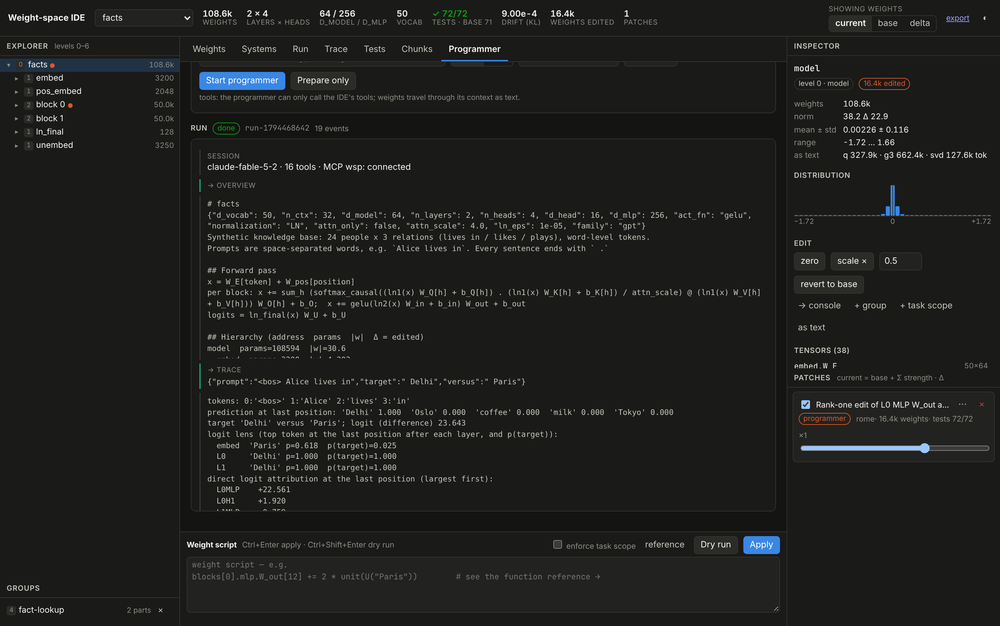
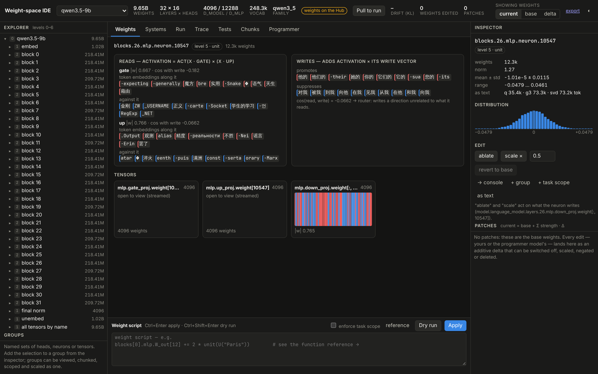
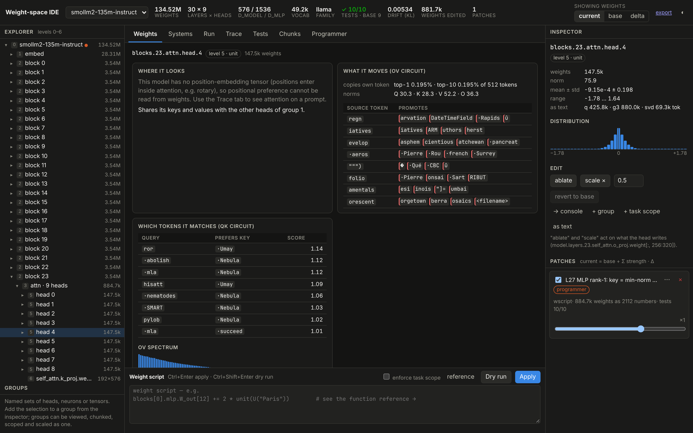
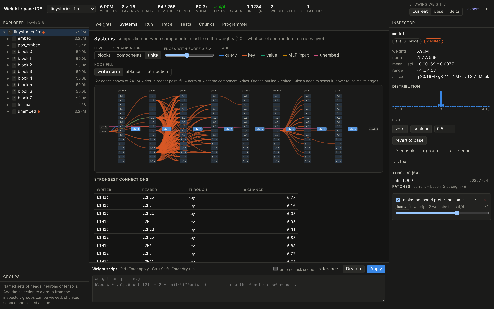

# Weight-space programming IDE

An IDE for changing what a neural network does by **writing its weights**: by hand, or by
handing the job to a programmer model that reads the weights and writes them back.

```
pip install -r requirements.txt
pip install -r requirements-search.txt   # only for the automatic search of behaviour directions (Optuna)
pip install -r requirements-datasets.txt   # only to read parquet/arrow datasets for behaviour directions (pyarrow)
pip install -r requirements-quantized.txt   # only for packed GGUF inference: the validated pins (the native build is separate, docs/QUANTIZED.md)
python -m wsp serve --model facts                                   # a toy model, trained in under a minute
python -m wsp serve --model HuggingFaceTB/SmolLM2-135M-Instruct     # a floating-point safetensors checkpoint on the Hub
python -m wsp serve --model /path/to/checkpoint_dir                 # or on disk
```

An environment made by `uv venv` has no `pip` inside it, and `python -m pip` answers
`No module named pip`. Install with uv there, naming the environment's interpreter:

```
uv pip install --python .venv/bin/python -r requirements.txt
uv pip install --python .venv/bin/python -r requirements-search.txt -r requirements-datasets.txt
```

The same form works for every requirements file named in these docs and in the IDE's own
messages. Restart the IDE after installing an optional file.

The IDE is at http://127.0.0.1:8765. Opening a safetensors checkpoint reads headers,
config and tokenizer; weight regions are fetched on demand. Running it loads its
inference runtime. For GGUF, use [portable user configuration and regular serve](docs/RUNTIME.md),
the [pinned native build](docs/QUANTIZED.md), and check the [tested operation matrix](docs/SUPPORT.md).

| Need | Where |
|---|---|
| See weights | Weights tab: zoomable signed heatmaps for any tensor (streamed for large ones), small multiples per head, explicit SVD/vocabulary readings, head and neuron cards |
| Edit weights | Click a cell; scale / ablate / revert anything from the inspector, including named selections of thousands of neurons, with a before/after view of edited weights; or write a *weight script* in the console. Every edit is a patch stored as a compact delta. [`docs/SELECTIONS.md`](docs/SELECTIONS.md) |
| Test and talk to the model | Run tab (completion and chat, base vs edited side by side, text shown while it is generated, a Stop button, optional steering of the edited reply), Probe tab (activation reads, top neurons, contrast, next-token change), Trace tab (logit lens, attribution, attention, activation patching), Tests tab |
| Remove a behaviour | Behaviour directions: measure the mean residual stream of two sets of prompts at every layer, then remove their difference from chosen layers' attention and MLP output matrices as a low-rank patch (plain, norm-scaled or norm-preserving), or fit a low-rank change per matrix from the saved matrix inputs and outputs (`ablate_ara`), through a weight script. Directions tab: measure from prompt sets or datasets, look at it per layer, preview, dry-run and apply the edit, compare two states' scores and responses, and run Heretic's automatic search with its live trials and Pareto front, committing a chosen trial. [`docs/DIRECTIONS.md`](docs/DIRECTIONS.md) |
| Check, deliver and repeat a behaviour edit | [Score a modified checkpoint](docs/DIRECTIONS.md#scoring-a-modified-checkpoint-heretics-evaluate_model), a PEFT LoRA adapter or another workspace against the base, as Heretic's `evaluate_model` does. [Steer along a measured direction](docs/DIRECTIONS.md#steering-along-a-direction) while the model runs, without changing a weight. Write the workspace's patches as a [PEFT LoRA adapter](docs/DIRECTIONS.md#a-lora-adapter-peft). Every committed direction edit keeps a [reproduction record](docs/DIRECTIONS.md#the-reproduction-record): it can be [run again](docs/DIRECTIONS.md#re-running-an-edit) from the record, the record can be written as Heretic's `reproduce.json`, and a `reproduce.json` that Heretic wrote [can be run here](docs/DIRECTIONS.md#running-a-heretic-reproducejson). The Directions tab's Output view has the adapter, the records and the re-run. Directions also run [in bfloat16](docs/DIRECTIONS.md#runs-in-bfloat16), [on a GGUF base](docs/DIRECTIONS.md#on-a-gguf-base) and on [hybrid and mixture-of-experts layouts](docs/DIRECTIONS.md#hybrid-and-mixture-of-experts-layouts); each section says what was compared with Heretic and what was not |
| Know what you are editing | Atlas tab: a map of every neuron (what it reads and writes, classes, token concepts, how it fires), a finder and per-prompt attribution that turn into weight scripts. [`docs/ATLAS.md`](docs/ATLAS.md) |
| Levels of organisation | Explorer: model → section → layer → attention / MLP → unit group → head / neuron → tensor, plus the checkpoint's own name tree. Systems tab: the composition graph, analysed a window of layers at a time, with progress and Cancel. [`docs/SYSTEMS.md`](docs/SYSTEMS.md) |
| Chunks, sections, groups | Any node is an address; named groups of addresses; the Chunks tab cuts a selection along the hierarchy to fit a token budget |
| A programmer model that updates the weights | Programmer tab: a task (instructions, scope, tests, drift limit) is handed to a model running in Claude Code, Codex or oh-my-pi, connected to the IDE over MCP. [`docs/PROGRAMMER.md`](docs/PROGRAMMER.md) |
| Take the edit out of the IDE | A patch file with only the tensors that changed, or the whole edited checkpoint (`python -m wsp export`). For a `transformers` checkpoint, a PEFT LoRA adapter. For GGUF, the Export tab: a companion that keeps the FP32 patches and undo beside the exact original base, or a standalone GGUF in a chosen precision with a size preview. [`docs/MIXED_EXPORT.md`](docs/MIXED_EXPORT.md) |
| Limits on memory and context | Settings tab, available without an open model: saved defaults, memory limits and what a change would cost. [`docs/SETTINGS.md`](docs/SETTINGS.md), [`docs/CAPACITY.md`](docs/CAPACITY.md) |









Prior work and what was borrowed from it: [`docs/PRIOR_WORK.md`](docs/PRIOR_WORK.md).
Recorded programmer runs: [`docs/RUNS.md`](docs/RUNS.md).
Graceful Ctrl-C shutdown and the temporary old-version workaround: [shutdown guide](docs/SHUTDOWN.md).

Weight inspection computations now require explicit actions; see [inspection controls, caching and upgrade behavior](docs/INSPECTION.md).

All the guides:

| Guide | About |
|---|---|
| [ATLAS](docs/ATLAS.md) | the map of a model's neurons, the finder and attribution |
| [DIRECTIONS](docs/DIRECTIONS.md) | behaviour directions: measuring, ablating, scoring, searching, exporting, reproducing; every comparison with Heretic |
| [STEERING](docs/STEERING.md) | steering while the model runs, and the probes |
| [SELECTIONS](docs/SELECTIONS.md) | selections and the inspector's scale / ablate / revert |
| [INSPECTION](docs/INSPECTION.md) | which weight computations run only when asked for |
| [SYSTEMS](docs/SYSTEMS.md) | the composition graph and its read limits |
| [PROGRAMMER](docs/PROGRAMMER.md), [RUNS](docs/RUNS.md) | the Programmer tab; recorded programmer runs |
| [RUNTIME](docs/RUNTIME.md), [SETTINGS](docs/SETTINGS.md), [CAPACITY](docs/CAPACITY.md) | user configuration and GGUF serving, the model worker, live text and Stop; settings; context and memory capacity |
| [QUANTIZED](docs/QUANTIZED.md), [SUPPORT](docs/SUPPORT.md), [QWEN38](docs/QWEN38.md) | GGUF support and the native build; the tested matrix; the 27B work and its partial acceptance |
| [MIXED_EXPORT](docs/MIXED_EXPORT.md) | standalone GGUF export in mixed precision |
| [SHUTDOWN](docs/SHUTDOWN.md) | Ctrl-C and shutdown |
| [PRIOR_WORK](docs/PRIOR_WORK.md) | prior work and what was taken from it |

## 1. The idea in one screen

```
                 ┌────────────────────────── IDE (python -m wsp serve) ──────────────────────────┐
 browser  ◄────► │  workspace = lazy checkpoint + patch stack       tests · drift · analysis      │
                 │  one edit path: weight script → scope check → tests on candidate → patch      │
                 └───────▲───────────────────────────────────────────────────────▲──────────────┘
                         │ HTTP                                                   │ live events
                 ┌───────┴────────┐   stdio MCP    ┌──────────────────────────────┴─────────────┐
                 │ python -m      │ ◄────────────► │ Claude SDK / Codex app-server / omp -p    │
                 │ wsp.mcp        │                │ prompt = BRIEF.md (task, model, rules)      │
                 └────────────────┘                └────────────────────────────────────────────┘
```

The harness and the person at the browser work on the same weights. When the programmer model
commits an edit, the patch appears in the patch stack, the explorer marks what changed, and
the test counter in the top bar moves.

## 2. Any model

Weights stay exactly as the checkpoint stores them: its names, its layout, its dtype. What
differs between architectures is described once (`wsp/arch.py`) as a *structure*: "these axes
of this tensor play this role". Everything else is written against roles.

| Layer of support | What it needs | What you get |
|---|---|---|
| **Any safetensors checkpoint** | nothing | the name tree, views, statistics, SVD, edits, chunks, export. Works for files that are not language models at all |
| **Recognised decoder architectures** | tensor names that match a known layout | layers, heads, key-value groups, neurons as addresses; cards; the composition graph; architecture-independent weight scripts |
| **Runnable models** | `transformers` can load it, and the files are on disk | completion, chat (through the model's own chat template), tests, drift, trace, patching, ROME |

Recognition is from tensor names, shapes and `config.json`, per layer. These layouts are known:

| Family | Attention weights | MLP weights |
|---|---|---|
| Llama-like (Llama, Mistral, Qwen, SmolLM, TinyLlama, StableLM, Phi-2, …) | `self_attn.{q,k,v,o}_proj`, grouped keys/values | `mlp.{gate,up,down}_proj` (gated) or `fc1`/`fc2` |
| GPT-2 | `attn.c_attn` (Q, K, V fused; Conv1D) | `mlp.c_fc`, `mlp.c_proj` |
| GPT-Neo | `attn.attention.{q,k,v}_proj`, `out_proj` | `mlp.c_fc`, `mlp.c_proj` |
| GPT-NeoX / Pythia | `attention.query_key_value` (fused, interleaved per head) | `mlp.dense_h_to_4h`, `dense_4h_to_h` |
| Phi-3 | `self_attn.qkv_proj` (fused) | `mlp.gate_up_proj` (fused), `down_proj` |
| this project's own small models | `W_Q [head, d_model, d_head]` … | `W_in`, `W_out` |

A layer whose attention is not recognised still gets its MLP neurons and keeps its other
tensors reachable by name. `Qwen/Qwen3.5-9B`, whose decoder mixes softmax attention with a
recurrent mixer, opens with neurons in all 32 layers and heads in the 8 softmax layers;
a Mamba checkpoint opens as a name tree.

How this was checked:

- **Behaviourally, on five layouts** (`tests/test_hf.py`; tiny random Llama with grouped K/V,
  GPT-2, GPT-NeoX, Phi-3 and GPT-Neo models built offline). For every head and for several
  neurons, editing the weights the IDE says belong to that unit gives the same logits as
  zeroing that unit's activation in the forward pass; zeroing one head's value read silences
  exactly its key-value group; direct logit attribution sums to the logit; an exported
  checkpoint loads in plain `transformers` and reproduces the edited model.
- **On two real models, run here**: `HuggingFaceTB/SmolLM2-135M-Instruct` and
  `Qwen/Qwen2.5-0.5B-Instruct`. Same weight-versus-activation checks (differences of exactly
  0), attribution adding up to the logit, chat through the model's template.
- **From file headers only** (structure recognised, nothing run): GPT-2, Pythia-14M,
  Phi-3-mini, Phi-2, TinyLlama-1.1B, Zephyr-7B (Mistral), StableLM-2-1.6B, Qwen3.5-9B.

Adding a layout is a matter of rules, not code paths: `arch.py` has one table of name patterns
for attention tensors and one for MLP tensors (each rule says which role a tensor plays; fused
tensors say how they are split), and `tests/test_hf.py` checks a new family the same way as
the others once a tiny model of it is added to `build()`.

Gated repositories need `HF_TOKEN` in the environment. Models run on the CPU in float32 by
default; `WSP_RUN_DTYPE=bfloat16` halves the memory (checked on SmolLM2-135M: same edit, same
answers; in `bfloat16` or `float16` a patch on a linear layer is added through a float32 side
path, see [runs in bfloat16](docs/DIRECTIONS.md#runs-in-bfloat16)), and `WSP_DEVICE` moves the
model to a GPU. `mps` ran `Qwen/Qwen3.5-4B` in bfloat16 for the
[comparison with Heretic](docs/DIRECTIONS.md#compared-with-heretic-on-qwen35-4b); `cuda` is
written but not tested. A memory preflight refuses unknown or insufficient
available memory; this estimate is not a guarantee against later allocation growth.
Authorized small GGUF tests require the external macOS/Linux watchdog described in
[Quantized support](docs/QUANTIZED.md), with separate workspaces and explicit limits.

[Mixed-precision standalone export](docs/MIXED_EXPORT.md) adds F16/Q8/F32 tensor promotion,
metadata-only size preview and explicit guarded behavioral validation; export itself never runs inference.

GGUF import, logical edits and packed CPU/optional Metal inference are supported for the explicitly
validated configurations in the [support matrix](docs/SUPPORT.md). Views reconstruct
quantized weights, not original full precision; FP32 patches preserve undo and companion
export. [Qwen3.8-27B implementation and supervised validation status](docs/QWEN38.md)
are tracked separately: actual27B edit/companion tests passed, standalone gain preservation
failed, and27B browser acceptance is incomplete. Use companion delivery for faithful edits;
no full-support or standalone-equivalence claim is made. Packed MLX and scaled FP8 logical decoding are not implemented and fail explicitly.
Checkpoints that exist only as `.bin` are converted to safetensors
on first open (which loads them whole, once). Encoder-only and T5-style checkpoints (BERT and
T5 were tried) open as a name tree; other encoder–decoder models can be partly recognised
(Whisper's decoder self-attention is) and are not runnable here.

## 3. Never loading the model

This section describes inspection and editing. Inference still needs a runtime and
memory budget. GGUF inference keeps the base packed and adds separate patch products;
small norms, biases and supported depthwise convolutions use FP32.

Three things make the cost of an operation the size of what it touches, not the size of the
model.

**A lazy store** (`wsp/store.py`). Local safetensors files are memory-mapped; files on the Hub
are read by HTTP range request and cached per tensor. Opening a checkpoint reads its JSON
headers. Reading one neuron's read vector reads one row.

**Edits as compact deltas** (`wsp/delta.py`). A patch stores *pieces* per tensor: a dense
block on a region, low-rank factors, or sparse coordinates. A rank-one edit to a
4096 × 12288 matrix is 16,384 numbers. Reading any region of an edited tensor adds only the
parts of the pieces that fall inside it.

```
current[region] = base[region] + Σ over enabled patches of  strength · piece[region]
```

**Streaming where a whole tensor must be seen.** Heatmaps of large matrices are pooled slab by
slab; statistics of large regions are sampled (and labelled as estimates); SVDs of large
matrices are randomised and take two passes; products with the embedding matrices are
accumulated in slabs. A GGUF store refuses one read above 16M values, and the refusal names the
tensor, the size asked for and the limit. Weights rendered as text are then read in row slabs
and never held together (`q`, `g3`, `g2` and `sparse` give the same text as one read, `stats`
is summed slab by slab, `svd` uses the streamed SVD above 40M values), and the file route
writes and compares its `.npy` files slab by slab.

Measured on `Qwen/Qwen3.5-9B` (9.65B weights, 775 tensors, 19.3 GB), opened from the Hub on a
4-core machine with 15 GB of RAM, without downloading or loading the model:

| Operation | Time | Notes |
|---|---:|---|
| open (headers, config, tokenizer) | 5.9 s | 1 MB fetched; process memory 0.39 GB (0.23 GB before opening) |
| list the hierarchy | 0.2 s | parameter counts come from shapes |
| read one neuron (gate, up and write vectors) | 4.4 s | 98 MB fetched: its write vector is a column, so that tensor is cached whole |
| edit: ablate a neuron, add a rank-one term | 0.2 s | stored as 20,480 numbers |
| heatmap of a 4096 × 12288 matrix | 0.3 s | pooled 16 × 32 |
| randomised SVD of that matrix | 6.7 s | |
| what a neuron promotes, first time | 147 s | fetches the embedding and unembedding (4.1 GB) once, at about 27 MB/s |
| … each later neuron | 6 – 10 s | streamed products with a 248,320 × 4096 matrix |
| composition graph for one layer | 4.0 s | once that layer's tensors (about 0.4 GB) are cached; estimated through a 1024-dimensional random projection |
| export a patch file | 0.3 s | the one tensor that changed, 101 MB |

Peak memory over the whole session was 2.9 GB, most of it the tensor cache (`WSP_CACHE_MB`,
1.5 GB by default). The three neurons read this way show the token sets that an earlier neuron map, made
from a full pass over the checkpoint, found for them:
`L26.10547` their / 他的 / 她的 / 你的 at the positive end of its write vector, `L26.4797`
six / 六 / 六个 and `L20.3270` wait / 等待 / waiting at the negative end.

Running a model is the one thing that needs it whole: the runner (`wsp/runner.py`) loads it
through `transformers` the first time something has to be *run*, holds one copy, and switches
between base and edited weights by adding the patch pieces to the parameters in place and
putting the saved originals back. Switching costs the size of the edit, and returning to base
is exact. Models still on the Hub are view-and-edit until pulled (`python -m wsp pull <name>`,
or "Pull to run" in the top bar).

## 4. Addresses and patches

An **address** names any part of a model at any level, and is the unit of everything else
(views, chunks, task scopes, groups, edits):

```
model   blocks.3   blocks.3.attn   blocks.3.attn.head.5 (= L3H5)   blocks.3.mlp.neuron.17 (= L3N17)
blocks.3.attn.kvgroup.1   blocks.3.mlp.neurons.64-127   blocks.*.mlp   group:my-circuit
model.layers.3.mlp.down_proj.weight[:, 17]   raw:model.layers.3        (the checkpoint's own names)
```

`L3H5` resolves to head 5's rows of the query projection, the rows of the key and value
projections its group uses, and its columns of the output projection, whatever the
checkpoint calls them and however it lays them out.

A **workspace** is a directory: a pointer to the checkpoint (or the weights of a small
bundled model) and a stack of patches. Each patch can be switched off, scaled (the slider
runs from −1 to 2), deleted or exported independently, and records who made it, its source
(the script, the ROME request, …), its rank, and the test result at the time.
`python -m wsp export` writes the edited checkpoint file for file, one tensor in memory at a
time; the browser's export link downloads a patch file with only the tensors that changed.
The patches of a `transformers` checkpoint can also be written as a PEFT LoRA adapter, which
`PeftModel.from_pretrained` loads on the unchanged base
([a LoRA adapter](docs/DIRECTIONS.md#a-lora-adapter-peft)). A GGUF workspace exports from the
Export tab: a companion bundle of its FP32 patches for the exact original base, or a standalone
GGUF ([mixed-precision export](docs/MIXED_EXPORT.md)).

## 5. Weight scripts

Dense numbers are the most expensive way to say what a weight should be. A weight script says
it with directions that mean something and with structure, and is the same on every
architecture:

```python
n = neuron(0, 12)                                   # a lazy view: nothing is read yet
n.w_in  = 4 * unit(E(" cat"))                       # fire on " cat"        (gated MLPs: n.gate, n.up)
n.w_out = 3 * unit(U(" dog"))                       # promote " dog"

head(1, 3).O *= 0                                   # switch a head off
orthogonalize(unit(U(" the")))                      # remove a direction from everything that writes to the stream
rank1(mlp(2).W_out, k, v)                           # W_out += outer(k, v), stored as the two vectors

v = act("I love this", "blocks.2.hook_resid_post") - act("I hate this", "blocks.2.hook_resid_post")
mlp(2).b_out += 4 * unit(v)                         # a steering vector, baked into a bias (if the model has one)

P("model.layers.3.mlp.down_proj.weight")[17, 0:8] = 0   # any tensor by its checkpoint name
```

It is a Python subset (assignments, `for` / `if`, list, dict and generator comprehensions,
f-strings with format specs, arithmetic, indexing, a fixed list of functions, and the safe
built-ins `sorted` / `min` / `max` / `sum` / `any` / `all` / `reversed` / `tuple` / `dict` /
`set` with whitelisted list, dict and string methods) interpreted by walking the syntax tree in
`wsp/wscript.py`. There is no `eval`, no import, no `lambda` and no attribute access outside a
whitelist (`str.format` cannot look up attributes or items), so a script written by a model is
run as it stands. Python values are bounded, since memory admission sees only tensors: one list,
tuple or string holds at most 10M items, and every list, string, dict or set a script builds is
charged to an estimate of what it holds, at most 512 MB, so a loop or comprehension of small
values is refused as surely as one large value (a name rebound in a loop gives its old value
back). Text is written within those bounds (`str()` of `[x] * 1000` writes `x` a thousand
times), `print` keeps 20,000 characters of a line, and format widths and integers are capped
(`MAX_FORMAT_WIDTH`, `MAX_INT_BITS`). On a quantized (GGUF) model a whole
view used as a value is decoded in row slabs and held as FP32; a new whole read is refused when the
whole reads the script still holds would pass 320M values, and the error gives the row-slab loop to
write instead. That counts the decoded tensors only, not tensors computed from them (`x * 1`,
`x.clone()`): there is no whole-script total for tensor memory, which memory admission bounds one
operation at a time. Time is bounded by the step limit: work inside one call (a scan, sort, copy or
hash) counts against it in proportion to the items it touches, and `key=` takes only value functions. Views are lazy: `neuron(5, 12).w_out` reads one row or column
wherever the checkpoint lives, and assigning to it records a delta of that size. The full
reference is in the console's "reference" button and in the programmer's brief.

A behaviour direction measured from two sets of prompts is removed with `ablate_direction(...)`, or by a
fitted low-rank change per output matrix with `ablate_ara(...)`; see
[`docs/DIRECTIONS.md`](docs/DIRECTIONS.md).

Everything in the UI is also a script: clicking a cell or dragging a scale produces one,
which is how the language is learned.

Two complete programs written this way are in [`examples/`](examples/): a sequence reverser in
one attention head (52 non-zero weights) and addition mod 7 as two heads plus a 49-neuron
lookup table (248 non-zero weights). Applied to the all-zero `blank-*` models they take the
test suites from 0 % to 100 %:

```
python -m wsp apply --model blank-reverse examples/reverse.wscript
python -m wsp apply --model blank-modadd  examples/modadd.wscript
```

## 6. Weights as text, inside a token budget

A programmer model can only use weights that fit in its context. The cost per weight was
measured by sending 1,200 Gaussian weights through the Claude Code CLI in each format and
reading the input-token difference (November 2026, the session's default model):

| format | example | tokens / weight |
|---|---|---:|
| `q` — integers in ±999 × one scale per tensor | `-412 87 0 913` | **2.5** |
| integers in ±9 or ±99 | `-4 1 0 9` | 2.4 – 2.5 |
| integers in ±9999 | `-4120 870` | 3.2 |
| `g2` — 2 significant digits | `-0.041 0.0087` | 4.6 |
| `g3` — 3 significant digits | `-0.0412 0.00871` | 5.3 |
| scientific notation | `-4.12e-02` | 7.5 |
| `sparse` — index:value pairs | `17:-0.041` | 6.8 per entry (about 11 as rendered, with token labels) |

One, two and three digits cost the same, and a minus sign costs about one token, so the dense
format of choice is three-digit integers with a scale: about 10 bits per weight at half the
price of decimals. In round numbers a 1M-token context holds **about 300k weights** read
densely, with a quarter of the window left for instructions, tool traffic and thinking: one
head of a 9B model, not one of its matrices. Anything larger is read in parts or through a
lossy view (`svd`: singular values with the vocabulary readings of the leading directions;
`sparse`; `stats`).

`wsp/chunks.py` plans chunks by walking the hierarchy top-down and cutting at the highest
level that fits the per-chunk budget: whole layers if they fit, else attention and MLP, else
heads (or key-value groups) and runs of neurons, and row slabs only for single tensors that
are too big alone. A chunk is rendered as one document: a header that says where the weights
sit and what they do, then each tensor with its address in script syntax so it can be written
back. Rendering a chunk reads only that chunk.

```
python -m wsp plan --model tinystories-1m --budget 40000 blocks.3
```

The planner's estimates are deliberately a little high. Five rendered chunks (a head, a run of
neurons, a 16-head attention layer, an SVD view, a sparse view) were sent through the same
measurement, and the estimate was 7–22 % above the real count each time. Every chunk in a
dense plan is under the budget asked for, and the test suite checks that a plan covers every
weight exactly once, in every supported layout.

## 7. Tasks, tests and the programmer

A **test suite** is the specification (`wsp/testsuite.py`): next-token expectations, forbidden
tokens, logit differences, completions, and "stay within this KL of the base model". Each case
reports how far it is from flipping, so there is a number to move even without gradients.
**Drift** is the standing locality check: mean KL from the base model on calibration text.

A **task** is what the programmer model is given: instructions, a *scope* (addresses it may
change; anything else is rejected), a suite, and a drift limit.

The programmer has seventeen tools (`wsp/tools.py`), all text in, text out, all sized for a
context window:

```
overview  list_nodes  inspect  vocab            read the model's structure and meaning
plan_chunks  read_chunk  read_weights           read weights within a token budget
run  trace                                      run the model, look inside one forward pass
atlas                                           the map of the model's units: what carries a word, what pushes an answer
edit  rome                                      write weights (dry_run to preview)
run_tests  patches  finish                      check, undo, report
checkout_files  commit_files                    the file route: tensors as .npy for the harness's own tools
```

Every edit, the programmer's or a person's, takes one path (`Session.apply`): run the script,
check the scope, run the suite and the drift measurement on the candidate weights, and only
then commit a patch. The report that comes back (what changed and in what form, tests before
→ after, which cases broke, drift against the limit) is the programmer's feedback. For a
model that cannot be run here the edit is still checked and committed, and the report says
that it was not tested.

### Running a programmer

The IDE does not implement an agent loop; it uses a standard harness. Starting a run writes

```
<workspace>/agent/BRIEF.md     the task, the model, the rules, the weight-script reference
<workspace>/agent/.mcp.json    declares the `wsp` MCP server
```

and opens a native conversation there (or launches a legacy one-shot harness).

| Harness | Command the IDE runs | Status |
|---|---|---|
| Claude Code | Claude Agent SDK, persistent bidirectional streaming connection to the installed `claude` executable | protocol/lifecycle tests; historical one-shot results remain in `docs/RUNS.md` |
| Codex | `codex app-server`, persistent JSON-RPC connection and one thread across follow-ups | protocol/lifecycle tests |
| oh-my-pi | `omp -p "<brief>"` in the agent directory (reads `.mcp.json`) | legacy one-shot path |
| custom | any command; `{brief}` `{mcp_config}` `{url}` `{dir}` are substituted | legacy one-shot path |

For native conversations, install Node.js 20+ and the relevant agent CLI. Existing CLI
logins work automatically. Claude additionally needs the bridge dependency:

```sh
cd bridge
npm ci --omit=optional --ignore-scripts
npm test
```

The SDK uses the installed Claude executable, so its optional bundled CLI binaries are
unnecessary. The bridge preserves normal account/configuration environment variables;
it does not copy tokens, replace your login, or require a new API key. Provider account
and billing selection follow the CLI's existing authentication configuration.

The Programmer tab checks authentication before enabling **Start programmer**, and the
server performs a fresh check before launching a native conversation. If signed out,
choose **Sign in**, then **Open Claude sign-in** or **Open ChatGPT sign-in**. Claude asks
you to paste the code returned by its sign-in page; Codex finishes through its local
browser callback. The IDE verifies the resulting CLI status before enabling Start.
**Cancel sign-in** stops the attempt; **Check again** retries failed checks or notices a
login completed in another terminal. Pending sign-in survives a browser reload, expires
after ten minutes, and is cancelled when the IDE server shuts down. Finish or cancel
sign-in before changing the workspace/task. Restarting the server does not restore a
pending login.

Claude uses `auth status --json` and its supported `auth login --claudeai` flow; Codex
uses app-server `account/read` and `account/login/start`, completion and cancellation
messages, without starting a thread. Checks are cached for one minute outside launch.
Configured API/provider authentication remains supported, including Codex providers
that do not require OpenAI authentication. “Authentication configured” indicates local
credential/provider configuration, not a network validation of token validity or plan
entitlement; the provider validates these when an actual request is made. The IDE does
not log or persist pasted codes, and leaves credential storage to the installed CLI.
Authentication endpoints require the IDE's origin/host and a per-server request token;
provider URLs are restricted to supported HTTPS sign-in hosts.

**Start programmer** sends the task brief. After each turn the conversation remains idle;
**Send message** continues the same session/thread. Tool permissions and agent questions
appear inline. **Interrupt turn** stops current work; **Close conversation** ends its
processes and unlocks task/workspace selection. Closing the IDE server closes agent
process groups. Browser reloads recover the current server-side transcript and prompts.
While a conversation is open the tab shows it first (status line, prompts, log, follow-up),
other views and tree clicks leave it running, and the tab's name says from any view whether
it is working or waiting for your answer: see [the Programmer tab](docs/PROGRAMMER.md#coming-back-to-a-run).

Each conversation is also saved in `<workspace>/conversations/`, beside the agent's
working directory (files readable by your user account, which includes agents you run
as yourself; ignored by Git). After a server restart the tab lists the workspace's earlier
conversations (a damaged entry is one "unreadable conversation" row and never stops the
others, Start or Resume); **Open** shows one read-only, without contacting the provider, and offers
**Resume** (continue the provider's own session: Claude Agent SDK `resume`, Codex
`thread/resume`) or **New conversation**. When a conversation cannot be resumed (no
session recorded, the provider said the session does not exist, another IDE process holds
it, a legacy run, the workspace moved or the task changed) the tab says why; a failed
attempt for any other reason can simply be tried again. A resumed conversation's first message tells the
model that the workspace may have changed and lists the current patches. A conversation
cut off by a server stop mid-turn is recorded as interrupted, with the events that had
arrived. Details: [docs/PROGRAMMER.md](docs/PROGRAMMER.md#saved-conversations-and-resume).

While a run works, a status line above its log says what it is doing: waiting for the
model, running a named tool call (with how long it has run and how many calls wait
behind it), waiting for your response, or finished/failed/stopped. Each tool call shows
its own timer and then its duration; "no output for N s" appears after 60 s with no
event. Times come from event times and the server's clock, so they stay right after a
reload. Details: [docs/PROGRAMMER.md](docs/PROGRAMMER.md#status-line).

Claude `tools` mode removes built-in tools and exposes only WSP MCP tools. Codex `tools`
mode uses its read-only filesystem sandbox alongside WSP MCP edits; it may still perform
built-in read-only operations, and requests to expand command/file permissions are
rejected. In `files` mode the agents may request file/shell actions in the agent directory;
additional permissions are shown for explicit approval. Existing CLI tool policies can
permit actions without a prompt. OMP/custom commands retain their own permission policies.
A run signed in with a subscription (a claude.ai login or Claude Code OAuth token, a
ChatGPT login) shows no dollar cost and has no budget field. For a sign-in that may be
billed per call (an API key, a gateway token, a cloud provider, or a method the IDE does
not recognise) the result keeps the provider's estimated cost, and Claude keeps its
**Claude budget (USD, billed per call)** field, passed to the SDK as `maxBudgetUsd`, which
stops the run at that spend. Codex cannot enforce a dollar cap, so a nonzero budget is
rejected for Codex. Legacy/custom harnesses keep whatever cost estimate they report. See
[docs/PROGRAMMER.md](docs/PROGRAMMER.md#cost-and-budget).

The same directory works interactively (`cd <workspace>/agent && claude`), and the MCP
server is also served over HTTP at `POST /mcp`. Without a harness, "show the brief" gives
a prompt to paste into another chat model; its weight-script reply goes into the console.

The integration follows Orca's published architecture, independently adapted to this
Python service: [Claude SDK adapter](https://github.com/stablyai/orca/blob/28e0a0243c364e0292d59a5076a29b4d7ec68eda/src/main/claude/claude-stream-json-connection.ts)
and [Codex app-server adapter](https://github.com/stablyai/orca/blob/28e0a0243c364e0292d59a5076a29b4d7ec68eda/src/main/codex/app-server/codex-app-server-connection.ts).
The bridge owns transport and UI events; the provider harness owns the agent loop.

Validation on 2026-11-13: Claude Code 2.1.321 with Agent SDK 0.3.319 and Codex
0.167.0 each completed two cloud turns in one native session, recalled context from
the first turn, and closed cleanly. Both also called the actual `wsp.mcp` stdio proxy
against an isolated HTTP fixture's `overview` tool; Codex's WSP approval was explicitly
accepted. Browser checks covered streaming, follow-ups, permissions/questions, and
restoring an idle conversation after reload. No model weights were loaded or edited
in these integration checks; they do not establish weight-edit correctness. Authentication
checks also verified existing-account readiness and isolated signed-out/login-URL/cancel
flows for both installed CLIs without authorizing a new account or changing existing
credentials. Successful OAuth completion is covered by protocol fixtures; these checks
did not perform a real user sign-in.

Offline checks (no checkpoint loads, model inference, or credentials required):

```sh
python -m pytest -q tests/test_native_harness.py tests/test_agent_auth.py
node --test bridge/test/*.test.mjs
node --test tests/*.test.mjs
```

The page tests (`tests/*.test.mjs`) run the browser code in a fake DOM; they do not draw
anything in a real browser. The Programmer tab also has an opt-in check in a real headless
Chrome against a fake run (no provider, model or network call), described in
[docs/PROGRAMMER.md](docs/PROGRAMMER.md#how-this-is-tested):

```sh
WSP_BROWSER_TESTS=1 node --test tests/browser/programmer.browser.test.mjs
```

The Run tab's chat **Send:** toggle has one too, against the same fake IDE; it draws the
view at 1400 and 900 px and presses the toggle, and sends no message:

```sh
WSP_BROWSER_TESTS=1 node --test tests/browser/chat_toggle.browser.test.mjs
```

## 8. Models

Any Hub repo id or local directory works as `--model`, and in the model menu under "open
another model…". These are bundled for testing:

| Name | What |
|---|---|
| `facts` | Trained here in under a minute. 2 layers, d_model 64, word-level, 108k weights: a synthetic knowledge base of 72 facts, with a ready-made editing task ("Alice moves") |
| `shakespeare-char` | Trained here in about four minutes. 3 layers, d_model 96, character-level |
| `tinystories-1m`, `gpt2` | Imported and converted to this project's layout (runs without `transformers`). The TinyStories import matches the `transformers` forward pass to 1e-4 in the logits |
| `blank-reverse`, `blank-modadd` | All-zero weights, no LayerNorm, and a test suite: programs to be written from nothing |

Workspaces live in `workspaces/` (not committed).

### Commands

Commands that work on a workspace take `--root` (default `workspaces`, or `WSP_ROOT`) and,
where they work on one model, `--model`.

| Command | What it does |
|---|---|
| `python -m wsp serve` | serve the IDE. `--empty` starts without opening a workspace; `--config`, `--profile` and a flag per setting are in [docs/RUNTIME.md](docs/RUNTIME.md) |
| `python -m wsp doctor` | print the effective configuration and setup as JSON without loading weights; `--inspect-model` also reads a GGUF header for the parameter count and a memory estimate |
| `python -m wsp models` | list the bundled models and the workspaces under the root; `*` marks those already built |
| `python -m wsp build <name>`, `open <spec>`, `pull <name>` | make or open a workspace and print its summary; `pull` (or `open --pull`) downloads the weights so the model can be run |
| `python -m wsp apply <script>` | apply a weight script through the one edit path; `--dry-run`, `-m <message>`, `--patch-limit-gib` |
| `python -m wsp test` | run the workspace's test suite (`--suite` names another) |
| `python -m wsp plan [addresses]` | plan chunks for a token budget (`--budget`, `--format`) |
| `python -m wsp export <directory>` | write the edited checkpoint |
| `python -m wsp brief` | print the programmer's brief (`--mode tools` or `files`) |
| `python -m wsp atlas` | build the atlas (`--stages`, `--fetch`, `--corpus`, `--force`) or print it (`--show overview`, `L<layer>N<n>` or `concepts`) |
| `python -m wsp mcp` | the stdio MCP server a harness starts (`--url` of the IDE) |
| `python -m wsp.memory_guard --log <file> --forecast-gib <n> <command>` | run a command under the memory preflight and the external watchdog ([docs/QUANTIZED.md](docs/QUANTIZED.md)) |

`python -m wsp worker` is internal: the supervisor starts it.

## 9. Layout

```
wsp/store.py        lazy tensors: memory-mapped / range-requested safetensors, streaming writer
wsp/delta.py        edits as block / low-rank / sparse pieces
wsp/arch.py         structure of a checkpoint: parts and their roles, per architecture
wsp/workspace.py    lazy checkpoint + patch stack, views (Ref), scopes, export
wsp/semantic.py     heads, neurons, embeddings in one canonical layout for every architecture
wsp/addressing.py   address → (tensor, index) slices
wsp/hierarchy.py    the seven-level tree, the name tree, the chunk partition
wsp/runner.py       running models: this project's own, and anything transformers loads; standard hook points
wsp/runtime_layouts.py  a checkpoint's tensor names as the names of the model transformers loads
wsp/wscript.py      the weight-script interpreter
wsp/directions.py   behaviour directions: measurement (worker job direction_residuals), directions, directional ablation
wsp/directions_ara.py  the fitted low-rank ablation (ARA) from saved output-matrix inputs and outputs
wsp/directions_*.py  the rest of behaviour directions: scores, response prefixes, prompt sets from datasets, prompt rendering,
                    the automatic search and its sampler, scoring a modified checkpoint, reproduction records, running a Heretic reproduce.json
wsp/adapter_export.py, peft_adapter.py   patches written as a PEFT LoRA adapter; an adapter directory read back
wsp/steering.py, probes.py   steering while the model runs; activation probes
wsp/selections.py, compare.py   selections that can be scaled, ablated or reverted; before / after views of a tensor
wsp/inspection.py, wiring_stream.py   the bounded cache of inspection results; streamed reductions for the Systems graph
wsp/analysis.py     matrix views, SVD, head / neuron cards, wiring, trace, patching, ablation
wsp/atlas/          the atlas: build (weights, wiring, observed stages), selectors, attribution, token shifts
wsp/chunks.py       text formats, token estimates, chunk planning and rendering
wsp/testsuite.py    behavioural tests and drift
wsp/edits.py        ROME, the file route, checkpoint-as-patch
wsp/session.py      task, the single edit path, the programmer's brief
wsp/tools.py        the programmer's tools
wsp/mcp.py          MCP server (stdio proxy and JSON-RPC handler), standard library only
wsp/harness.py      Claude Code / Codex / oh-my-pi / custom launchers and event normalisation
wsp/agent_auth.py   Cached auth preflight, explicit sign-in, cancellation and process cleanup
wsp/native_harness.py, conversations.py   the persistent agent bridge; conversations saved on disk
wsp/gguf_store.py, gguf_runner.py, packed.py, overlay.py, hybrid_conv.py
                    GGUF: an immutable packed base decoded on demand; packed inference plus FP32 patch products
wsp/gguf_export.py, gguf_mixed.py, companion.py, export_jobs.py, export_quality.py
                    GGUF export: same-scheme merge, mixed precision, companion bundles, the one background export job, its acceptance suite
wsp/runtime_config.py, runtime_policy.py, runtime_supervisor.py, runtime_events.py, settings.py, capacity.py
                    per-user configuration, operation admission, the supervisor and its watchdog, saved settings, context capacity
wsp/memory_guard.py, memory_forecast.py, edit_limit.py   memory preflight and watchdog, allocation estimates, the largest patch one edit may write
wsp/worker.py, worker_jobs.py, worker_lease.py, worker_protocol.py, remote_runner.py
                    the model worker process a supervised GGUF model runs in, and the server's side of it
wsp/token_stream.py, generation_stop.py   live text of a generation; stopping one
wsp/lifecycle.py    shutdown
wsp/server.py       HTTP API; web/ is the browser app (no build step)
wsp/hub.py, zoo.py  Hub access; bundled models
wsp/model.py        the forward pass of this project's own small models
bridge/             the Node bridge to the Claude Agent SDK and the Codex app-server (npm test)
native/             the packed CPU and Metal kernels, built by scripts/build_packed.py and build_packed_metal.py
scripts/            native builds, guarded GGUF validations, the comparisons with Heretic
examples/           two complete weight-script programs
tests/              python -m pytest tests     (test_hf.py needs transformers)
```

## 10. Limits

- **Running is not lazy.** Everything about weights is; a forward pass needs the whole model
  in memory, through `transformers` or, for GGUF, as the packed base.
  Through `transformers` the largest model run is `Qwen/Qwen3.5-4B` (4.66B weights, bfloat16 on
  an Apple GPU, for the comparison with Heretic in [`docs/DIRECTIONS.md`](docs/DIRECTIONS.md#compared-with-heretic-on-qwen35-4b)).
  Packed GGUF runs are the ones in the [support matrix](docs/SUPPORT.md), the largest a
  supervised 27B sequence with partial acceptance. The 9.65B safetensors model of §3 was
  viewed and edited but not run, so edits to it were not tested.
- **Dense reads of whole large tensors are your decision.** Viewing a matrix streams it, but a
  script that uses a whole 100 MB tensor as a value reads it, and a column of a remote tensor
  fetches the tensor (rows are contiguous on disk, columns are not).
- **Recognition is by naming convention.** An architecture with other names opens as a name
  tree until a rule is added to `arch.py`. Recurrent and state-space mixers are not modelled
  as heads. Only five layouts are verified behaviourally; the others in §2 are recognised from
  headers and assumed to follow the same conventions.
- **Weight-only readings** (cards, the composition graph, SVD readings) ignore normalisation
  and everything upstream, and positional preference can only be read where positions are a
  tensor. For wide or many-component models the composition graph is estimated through a
  random projection with its bias removed. Where exact scores were also computed, the
  estimates were off by 0.05 rms (205 head pairs of SmolLM2-135M, scores 0.7 to 4.6) and by
  0.015 rms (32 head-to-MLP pairs of one layer of Qwen3.5-9B, scores 0.9 to 1.3).
- **ROME** here uses the prompt's own key and a small self-sampled calibration corpus for the
  covariance. On the 2-layer `facts` model it is clean at the layer where the fact is stored;
  on SmolLM2-135M it reached the target at three layers and broke 4 to 8 of 9 neighbouring
  facts each time, and the programmer model's own contrast-set edit did better (`docs/RUNS.md`).
- **Token estimates** come from one tokenizer measured once. Other models will differ.
- **What has been demonstrated** is programming models from 2k to 135M weights, and viewing and
  editing one of 9.65B. Nothing here shows that weight-space programming of non-trivial
  behaviour scales with model size; the lazy store, chunker and lossy views are the tools for
  finding out.
- **Security.** The server is for local use. It binds to 127.0.0.1, has no authentication, and
  the custom-harness option runs a command line that the browser supplies. Do not expose it.

## 11. Running, steering, settings and the model worker

The **Settings** tab is available without an open model: [interactive defaults, persistent policy and memory impact](docs/SETTINGS.md). On a supervised server (`wsp serve`) saved memory limits and the idle timeout apply at once, and context, CPU threads and backend at the next model load; saving never restarts the server or loads a model, and a save whose new limits would make the memory watchdog unload the loaded model asks for confirmation first.

Run and Chat show text while it is generated: the edited model's reply first, then
the base model's. See [Live text in Run and Chat](docs/RUNTIME.md#live-text-in-run-and-chat).
A Stop button ends a pending reply; a stopped chat turn is not kept and its message
goes back into the box. See [Stopping a reply](docs/RUNTIME.md#stopping-a-reply).

Steering pushes neurons, whole MLPs and heads while the model runs, without changing a
weight or recording a patch; probes read activations (per-token reads, top firing
neurons, contrast between two text sets, next-token change). Run and Chat steer the
edited reply from a steering panel in the Run tab (entries, or a pasted
neuron-explorer recipe); the base reply is never steered. An entry can also be a measured
behaviour direction, `direction:<name>@<k>`, added to the residual stream
([steering along a direction](docs/DIRECTIONS.md#steering-along-a-direction)). The Probe tab
runs the probes: [steering and probes](docs/STEERING.md#in-the-browser).

Saved output tokens are a managed request default. Run/Chat controls set a ceiling: the server fits
the response into the context remaining after the complete prompt/history, without
truncating history. Failed Chat requests preserve the retry draft outside the
conversation. Settings' capacity preset searches the native model window against
the shared forecast; resident recommendations are physical upper bounds requiring
fresh admission after unload, not guarantees of free memory. See
[Settings](docs/SETTINGS.md) and [capacity details](docs/CAPACITY.md).

Managed GGUF operations now use fresh admission and structured refusal/abort/unload
events. Partial replies stay visible outside durable chat history. Idle timeout
unloads the model rather than expiring active work. A supervised GGUF model runs
in a separate model-worker process; the watchdog's last resort kills that worker,
never the IDE server, and the next Run loads the model afresh. See
[runtime policy](docs/RUNTIME.md#the-model-worker). `python -m wsp worker` is
internal: the supervisor starts it; do not run it by hand.

## License

Copyright (C) 2026 buttonscodes.

This program is free software: you can redistribute it and/or modify it under the terms of
the GNU Affero General Public License, version 3, as published by the Free Software
Foundation. It is distributed without any warranty. See [LICENSE](LICENSE).

The parts that reproduce Heretic for comparison (`scripts/heretic_fit_check.py`, one function
in `scripts/formats_shared.py` and one in `tests/test_directions_ara.py`) are copied from
[Heretic](https://github.com/p-e-w/heretic), which is under the same licence; each says so
where it stands. The steering reference text in `wsp/steering.py` is from neuron-explorer,
under the MIT licence, with its notice kept beside it.
